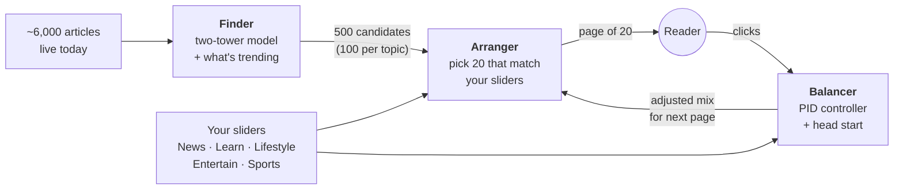
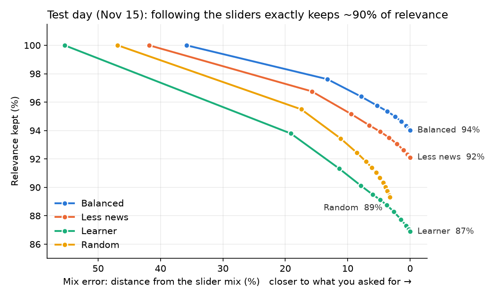
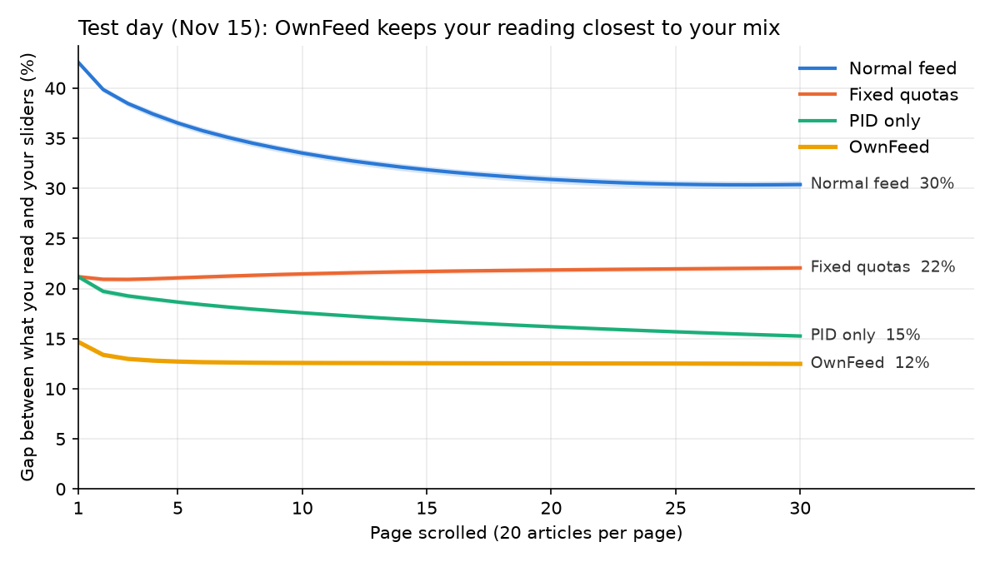

# OwnFeed

**Your feed, your rules.** A news recommender where you set the topic mix with sliders, and the feed sticks to it, instead of drifting toward whatever you click most.


*Same reader, same articles. The normal feed gives a news lover ~80% News no matter what. OwnFeed follows the sliders. When the mix changes, OwnFeed follows; the normal feed doesn't.*

---

## The problem

Engagement-optimized feeds show you more of what you already click. That works for clicks, but it means **you don't get to decide what your feed is made of**. Someone who reads a lot of news gets an ever-newsier feed, even if they'd *like* more science, food or sport.

OwnFeed asks: **can a recommender follow a mix the user chooses, and what does that cost?**

## How it works

Three stages, each with one job. Think of a bookshop assistant (finder), a shelf arranger (arranger) and cruise control (balancer):



| Stage | What it does | How |
|---|---|---|
| **Finder** | Narrows ~6,000 live articles to 500 the reader would likely enjoy, **100 from each topic** so no topic runs dry | Two-tower model on frozen [MiniLM](https://huggingface.co/sentence-transformers/all-MiniLM-L6-v2) text embeddings (title, abstract, category). Score = taste similarity + 0.05 × log(1 + clicks in the last 24 h) |
| **Arranger** | Picks the 20 articles you see so the page matches your sliders | Greedy re-ranker: each pick maximizes `relevance + strictness × open slots in that topic`. Strictness 0 = normal feed, 0.5 = matches the sliders on ~95% of pages |
| **Balancer** | Keeps what you actually **read** close to your sliders as you scroll | **Head start:** from your past clicks, predict which topics you'll under-read and show a bit more of them. **PID controller:** after each page, compare clicks with the target and nudge the next page |

The five topic sliders group MIND's 17 categories: **News** (news, weather), **Learn** (finance, health, science & tech), **Lifestyle** (food, travel, autos, home), **Entertain** (TV, movies, music, celebrities, video) and **Sports**.

## Results

All numbers are on the **locked test day (Nov 15)**, which was run **once** with every setting frozen. Every choice was made on the validation day (Nov 14). Validation numbers are in [`results/test_vs_validation.csv`](results/test_vs_validation.csv).

### 1. The finder beats "show what's trending"

| Finder (100 per topic) | Recall@500 | NDCG@10 |
|---|---|---|
| Random | 0.093 | – |
| Trending (most clicks, last 24 h) | 0.838 | **0.152** |
| **OwnFeed: two-tower + trending** | **0.859** | 0.150 |

The 500 candidates catch 86% of what readers clicked. At the very top of the list it **ties** with trending; see the findings below for why.

### 2. Following your sliders keeps ~90% of relevance



A normal feed is **36–55 points** away from the requested mix. At the chosen strictness (0.5), **96% of pages match the sliders exactly** while keeping **91% of relevance**. Strictness 0.5 is the smallest value where at least 90% of pages match exactly; the choice is documented in [notebook 06](notebooks/06_arranger.ipynb).

### 3. OwnFeed keeps what people *read* closest to their mix

Showing the right mix isn't enough: people still click their favorite topic more. We tested this with **simulated readers**, built from a click model fitted on real MIND clicks (AUC 0.70 on held-out users), each scrolling 30 pages.



| After 30 pages (target: 20% per topic) | Gap from sliders | Favorite topic's share of reading | Click rate |
|---|---|---|---|
| Normal feed | 30% | 41% | 3.7% |
| Fixed quotas (arranger only) | 22% | 34% | 3.4% |
| PID only | 15% | 26% | 2.9% |
| **OwnFeed (head start + PID)** | **12%** | **25%** | 2.9% |

2,000 simulated readers × 5 runs; bands show ±2 standard errors.

### Speed

Building one page (finder + arranger + balancer) takes **~1 ms** on a laptop CPU.

## Key findings

1. **Control is cheap on relevance.** Matching the slider mix exactly keeps about 90% of the relevance of an unconstrained feed.
2. **Control costs clicks.** Click rate drops from 3.7% to 2.9% (about −20%). People click less when they read what they *asked for* rather than what they *naturally* click. This is the stated-vs-revealed preference trade-off, measured.
3. **The head start does most of the balancing; the PID is the safety net.** In a validation stress test, when readers behave exactly like their history, the head start alone is as good as the full balancer (gap 9.5% vs 9.8%). When today's taste differs strongly from history, the PID clearly helps (13% vs 16%).
4. **Personalization helps less on big-news days.** On the test day the 10 most-clicked articles took **32% of all clicks** (vs. 21% on the validation day). On a day like that, "what's hot" ties with personal taste at the top of the feed. Taste still helps further down the list.
5. **A normal feed doesn't trap you within one session.** The expected "filter bubble" drift didn't show up within a 30-page session: the normal feed runs out of fresh favorite-topic articles. Bubbles build over weeks, not one scroll. The real gap is that a normal feed **ignores your stated preferences from the start**.

## Design decisions

- **Time-based evaluation.** Train on Nov 9–13, validate on Nov 14, test on Nov 15 (`MINDsmall_dev`). Never a random split, because news is about *today*. 53% of validation articles never appear in training, which is why the item tower reads text instead of memorizing article IDs.
- **Locked test set.** Every setting (trending weight 0.05, strictness 0.5, PID gains 0.5 / 0.05) was chosen on validation. The test day was run once, and the results above are reported as they came out.
- **Per-topic candidate quotas.** Without them, a news lover's 500 candidates would be nearly all News and the arranger couldn't fill a Sports slot. Quotas cost almost nothing (Recall@500 0.786 → 0.777 on validation).
- **Honest simulation.** Simulated readers have a *fixed* true taste. Only the feed's picture of them changes as they click, so the simulation doesn't build in drift. The feed's own head-start model is fitted on different days from the simulator's "truth", so it never sees the answers.
- **What didn't work.** Training the two towers with the trending signal inside the loss was mixed (better top 10, worse Recall@500), so we kept the simpler setup: train on taste, add trending at scoring time. The towers also learn little beyond raw MiniLM similarity. Both experiments are documented in notebooks 05 and 07.

## Limitations

- **Simulated readers, not real people.** The balancer results come from a click model fitted on real clicks, not a live A/B test.
- **One day of articles per evaluation.** MIND-small has no publish times, so "live" means "shown to anyone that day".
- **Balanced targets only** in the balancer study; other slider settings were tested for the arranger.
- **The balancer can feel counter-intuitive.** To make a news lover *read* 20% News, it may *show* only ~5–10% News. A product would cap that (see future work).
- **MIND is news, not social posts.** It stands in for a social feed.

## Run locally

The demo isn't hosted: the [MIND license](https://github.com/msnews/MIND/blob/master/MSR%20License_Data.pdf) allows public demonstrations but not redistributing the data, so you need your own copy.

**1. Set up the environment** (Python 3.10+, developed on 3.14)

```bash
git clone https://github.com/Sukriti-124/OwnFeed.git
cd OwnFeed
python3 -m venv .venv && source .venv/bin/activate
pip install -r requirements.txt
```

**2. Get MIND-small** from [msnews.github.io](https://msnews.github.io) (requires accepting the Microsoft Research License) and unzip it so you have:

```
data/MINDsmall_train/   news.tsv  behaviors.tsv  …   (from MINDsmall_train.zip)
data/MINDsmall_test/    news.tsv  behaviors.tsv  …   (from MINDsmall_dev.zip, used as the locked test set)
```

> As of October 2026 the download links on the MIND site return an access error. If they're still down, check the site for updates.

**3. Build the model files** (~2–3 minutes; downloads MiniLM on first run)

```bash
python -m src.prepare
```

**4. Start the demo**

```bash
streamlit run app/streamlit_app.py
```

To reproduce the analysis, run the notebooks in order (`notebooks/01` → `08`).

## Repository

```
OwnFeed/
├── app/streamlit_app.py      # the demo
├── src/
│   ├── data.py               # loading MIND, topic buckets, time split
│   ├── finder.py             # trending baseline, MiniLM embeddings
│   ├── two_tower.py          # two-tower model, training, candidate retrieval
│   ├── arranger.py           # slider mix → slots, greedy re-ranker
│   ├── balancer.py           # PID controller + head start
│   ├── simulator.py          # click model fitted on real clicks, scrolling sessions
│   ├── metrics.py            # Recall@K, NDCG, mix error, relevance kept
│   ├── feed.py               # one-reader engine used by the demo
│   └── prepare.py            # one-command setup
├── notebooks/                # the analysis, in order (below)
└── results/                  # metrics CSVs and figures
```

| Notebook | What it covers |
|---|---|
| [01 · EDA](notebooks/01_eda.ipynb) | Categories, subcategories, click shares, choosing the 5 topic buckets |
| [02 · Split](notebooks/02_split.ipynb) | Time-based train/validation split and leakage checks |
| [03 · Baseline](notebooks/03_baseline.ipynb) | Trending finder and evaluation setup |
| [04 · Embeddings](notebooks/04_two_tower.ipynb) | MiniLM article vectors and sanity checks |
| [05 · Two-tower](notebooks/05_two_tower_train.ipynb) | Training, taste + trending blend, what didn't work |
| [06 · Arranger](notebooks/06_arranger.ipynb) | Strictness sweep, Chart 1, choosing strictness 0.5 |
| [07 · Balancer](notebooks/07_balancer.ipynb) | Simulator checks, head start + PID, Chart 2, mood-shift stress test |
| [08 · Test](notebooks/08_test_results.ipynb) | The single run on the locked test day |

## Future work

- **Bounded balancer:** keep each topic's share of the page within ½–2× its slider, so the page always *looks* like what you asked for.
- **"Breaking news" exception:** let a truly major story through even when your News slider is low.
- **Data engineering layer:** ingestion → DuckDB + dbt (tested marts, the topic mapping as a seed) → Dagster orchestration → Docker; a Kafka-style click stream for live trending.
- **A/B test plan** for a real launch: engagement *and* "did the feed match what I asked for?" survey metrics.
- **Stronger models:** fine-tuned text encoder, MIND entity embeddings, MIND-large.

## Data and acknowledgements

Built on **MIND: Microsoft News Recommendation Dataset** (Wu et al., ACL 2020), used under the [Microsoft Research License Terms](https://github.com/msnews/MIND/blob/master/MSR%20License_Data.pdf) for non-commercial research and demonstration. No MIND data is included in this repository. Text embeddings: [sentence-transformers/all-MiniLM-L6-v2](https://huggingface.co/sentence-transformers/all-MiniLM-L6-v2).
